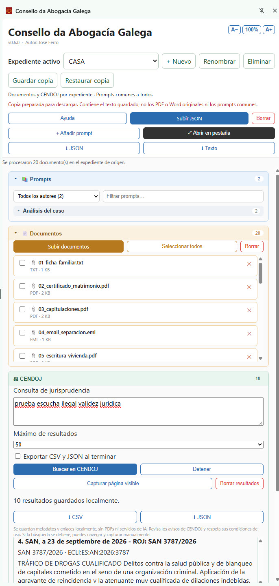

# Consello da Abogacía Galega

**Extensión de Chrome** (v0.6.0) con un panel lateral que reúne, en un solo sitio, una biblioteca compartida de **prompts** de IA y tus **documentos** de referencia. Autor: Jose Ferro.

## Captura de pantalla

Panel lateral con la biblioteca de prompts, los documentos de referencia y la búsqueda de jurisprudencia CENDOJ.



## ¿Para qué sirve?

Quien trabaja a diario con herramientas de IA suele repetir las mismas instrucciones y pegar los mismos documentos una y otra vez. Esta extensión lo resuelve:

- **Biblioteca de prompts.** Cargas un archivo JSON con los prompts del equipo y los tienes siempre a mano, organizados por categorías y filtrables por autor o texto.
- **Documentos de referencia.** Subes PDF, Word, Excel, LibreOffice, texto o correos `.eml` y la extensión extrae su texto automáticamente.
- **Combinar y copiar.** Marcas uno o varios prompts y uno o varios documentos, pulsas **Combinar y copiar** y obtienes un único bloque de texto. Se copia al portapapeles y se inserta en el campo de texto de la página en la que estás trabajando.

Ejemplo: marcas el prompt "Análisis de caso", marcas tres documentos del expediente, y con un clic tienes el prompt y los tres documentos juntos, listos para enviar a la herramienta de IA.

El panel se ancla a la derecha de la ventana de Chrome, ocupa todo su alto, se mantiene abierto mientras navegas y se puede ensanchar arrastrando su borde izquierdo.

### Principales funciones

- Panel lateral persistente, con opción de abrir la biblioteca completa en una pestaña.
- Casillas de selección en prompts y documentos, y botón **Seleccionar todos** para los documentos.
- Prompts compuestos: un prompt puede incluir otros por su nombre.
- Lectura de **PDF, Word (.docx), Excel (.xlsx/.xls), LibreOffice (.ods/.odt), texto (.txt/.md/.csv) y correos (.eml)**.
- Añadir prompts desde el propio panel y descargar la biblioteca en JSON o en texto.
- Interfaz en español, con tamaño de letra ajustable (botones **A−** / **A+**; por defecto un 20 % más grande que el tamaño base).

### Privacidad

Todo se procesa **dentro de tu navegador**. Ni los prompts ni los documentos se envían a ningún servidor; se guardan solo en el almacenamiento local de Chrome.

## Requisitos

- **Google Chrome 114 o superior** (en Windows o en Mac).
- No funciona en Safari, Firefox ni Edge.

## Instalación

La extensión no está en la Chrome Web Store, así que se instala manualmente en modo desarrollador. Lleva un par de minutos.

1. **Descarga el código.** En esta página de GitHub, pulsa el botón verde **Code** y elige **Download ZIP**.
2. **Descomprime el archivo** y mueve la carpeta a un lugar permanente (por ejemplo, Documentos).
   > ⚠️ No borres ni cambies de sitio la carpeta después de instalar: Chrome carga la extensión desde ella.
3. **Abre la página de extensiones** de Chrome: escribe `chrome://extensions` en la barra de direcciones y pulsa Intro.
4. **Activa el "Modo desarrollador"**, con el interruptor de arriba a la derecha.
5. Pulsa **Cargar descomprimida** y selecciona la carpeta descomprimida, la que contiene el archivo `manifest.json`.
6. Verás una tarjeta llamada **"Consello da Abogacía Galega"**. Para tenerla a mano, pulsa el icono del puzle 🧩 de la barra de Chrome y la chincheta 📌 junto al nombre de la extensión.

Para abrir el panel, pulsa el icono de la extensión (la balanza) en la barra de herramientas.

### Actualizar a una versión nueva

Descarga de nuevo el ZIP, sustituye los archivos de la carpeta y, en `chrome://extensions`, pulsa el icono de recargar ⟳ en la tarjeta de la extensión. Si usas Git, basta con `git pull` y recargar.

## Primeros pasos

1. Pulsa el icono de la extensión para abrir el panel y **Ayuda** para ver un resumen y la estructura del JSON.
2. En **📚 Prompts**, pulsa **Subir JSON** y elige un archivo de prompts. Para probar, usa `sample-prompts-es.json` (claves en español) o `sample-prompts.json` (claves en inglés), incluidos en esta carpeta.
3. En **📄 Documentos**, pulsa **Subir documentos** y elige uno o varios archivos. Para probar, usa `sample-document.txt`.
4. Marca con las casillas los prompts y documentos que quieras y pulsa **Combinar y copiar**.
5. Si tenías un cuadro de texto activo en la página (por ejemplo, el chat de una herramienta de IA), el texto se escribe ahí automáticamente. Si no, ya está en el portapapeles: pégalo con Ctrl+V (Windows) o Cmd+V (Mac).

## Formato del archivo de prompts

Es un JSON con una lista `prompts`. Solo es obligatoria la clave `texto` (o `text`); las claves se aceptan en español o en inglés.

```json
{
  "prompts": [
    {
      "nombre": "Resumir artículo",
      "fecha": "2026-08-01",
      "autor": "Alex",
      "categoria": "Redacción",
      "comentarios_del_autor": "Para sacar 3 ideas clave.",
      "incluye": ["Tono corporativo"],
      "texto": "Resume el siguiente artículo en 3 puntos."
    }
  ]
}
```

La descripción completa de todas las claves está en [DOCUMENTACION.md](DOCUMENTACION.md) y dentro de la extensión, en **Ayuda → Estructura del archivo JSON**.

## Limitaciones conocidas

- Los **PDF escaneados** (solo imagen, sin texto) no se pueden leer: no hay OCR.
- No se admiten los archivos **.doc** antiguos (guárdalos como `.docx`) ni los **.msg** de Outlook (expórtalos como `.eml` o texto).
- La lectura de `.eml` es básica: solo correos de texto plano.
- La inserción automática no funciona en páginas internas de Chrome (`chrome://…`) ni en la Chrome Web Store; el texto se copia igualmente al portapapeles.

## Más información

- [DOCUMENTACION.md](DOCUMENTACION.md): referencia completa de funciones, formato JSON y límites.
- [install-guide.md](install-guide.md): guía de instalación paso a paso para personas sin experiencia técnica.
- [THIRD_PARTY_LICENSES.md](THIRD_PARTY_LICENSES.md): licencias de las librerías incluidas en `libs/`.

## CENDOJ (v0.4)

La tercera sección, **CENDOJ**, está disponible tanto en el panel lateral como en
la biblioteca en pestaña. Introduce una consulta, elige 10, 25 o 50 resultados y
pulsa **Buscar en CENDOJ**. La extensión abre el buscador público, intenta rellenar
el formulario y recorre los números consecutivos de su paginación. Revisa los
avisos legales o validaciones de la web. No se eluden controles de acceso.

**Detener** conserva los resultados. Si la búsqueda automática no funciona,
realízala en la web, selecciona su pestaña y pulsa **Capturar página visible**.
Puedes avanzar manualmente y repetir la captura; se eliminan duplicados por
ECLI, ROJ o enlace. Una nueva búsqueda sustituye los resultados anteriores.

Los botones **CSV** y **JSON** exportan los metadatos y enlaces a la carpeta
`CENDOJ_Local` de Descargas. La casilla de exportación al terminar permite guardar
ambos formatos automáticamente. El CSV lleva BOM UTF-8 y separador de punto y
coma para Excel. No se descargan PDFs. La posición conserva el orden del buscador,
sin clasificación jurídica por IA.

Consulta y resultados se guardan en `chrome.storage.local`, compartidos entre las
dos vistas, sin cuentas, servidores, Python ni APIs de terceros. **Borrar resultados**
elimina estos datos. Los nuevos permisos `tabs` y `downloads` permiten controlar
la pestaña CENDOJ y exportar archivos; los permisos de las funciones anteriores
se conservan. El nuevo script de contenido solo se carga en
`https://www.poderjudicial.es/search/*`.

El proceso se detiene tras tres minutos o al reiniciarse el service worker y
conserva los datos recogidos. El DOM del CENDOJ puede cambiar: los selectores están
en `cendoj-content.js`. No se ha validado un recorrido contra la web real desde
este entorno, cuya política de red no permite acceder a CENDOJ. Revisa las
condiciones actuales de https://www.poderjudicial.es/search/indexAN.jsp antes de
una recopilación sistemática o reutilización. No es una herramienta oficial.

Para instalar: descomprime la extensión, abre `chrome://extensions`, activa el
modo desarrollador y carga la carpeta que contiene `manifest.json`. Si ya estaba
instalada, pulsa **Recargar** y vuelve a abrir el panel. No requiere compilación.

Verificación local: `node --check cendoj-background.js`,
`node --check cendoj-content.js`, `node --check cendoj-panel.js` y
`node --test tests/*.test.cjs`.


## Biblioteca de lectura y prompts iniciales

**Abrir en pestaña** abre un navegador de contenido, con una lista lateral de
Prompts, Documentos y CENDOJ y un lector central amplio. Al pulsar cada elemento
se muestra su texto individual completo, sin recortarlo. Puedes buscar por nombre
o contenido, copiar el texto y ampliar o reducir la letra. Los cambios del panel
se reflejan en la biblioteca abierta. El icono mantiene la balanza dorada con
fondo rojo oscuro en sus cuatro tamaños.

Los prompts compuestos incluyen el texto de sus referencias. Los documentos
muestran el texto extraído al subirlos. CENDOJ muestra los metadatos y el resumen
recogidos; estos datos no equivalen a la sentencia íntegra. En cada resolución
puedes abrir el enlace original y **Adjuntar texto íntegro** desde un PDF con capa
de texto, TXT, MD o DOCX para leerlo y conservarlo localmente. No hay descarga
masiva de PDFs ni reconocimiento OCR. El texto adjunto se conserva en su expediente al sustituir búsquedas; se elimina
al borrar ese expediente o los datos de la extensión.

Se añaden una sola vez dos prompts en la categoría **Análisis del caso**:
- **Estado del caso — informe para el abogado**: hechos, cronología, fase actual,
  pruebas, plazos documentados, riesgos y cuestiones pendientes.
- **Cómo proceder — estrategia y próximos pasos**: alternativas, recomendación
  motivada, plan priorizado e información que falta.

Para usarlos con todos los documentos: selecciona el prompt en el panel, pulsa
**Seleccionar todos** en Documentos y **Combinar y copiar**. El texto resultante
incluye los documentos seleccionados; el prompt por sí solo no transmite archivos
a una IA. Los prompts iniciales se añaden sin sustituir los existentes y no se
reponen automáticamente si el usuario los borra.


## Expedientes separados (v0.5.0)

El selector **Expediente activo** aparece en el panel lateral y en la biblioteca.
Permite crear, cambiar, renombrar y eliminar expedientes. Cada expediente guarda
sus propios documentos, consulta y resultados CENDOJ y textos íntegros adjuntos.
Los prompts —incluidos los dos prompts iniciales— son comunes a todos los asuntos.

Al actualizar, los datos anteriores se trasladan automáticamente a **Expediente
inicial**, sin modificar la biblioteca de prompts. El expediente activo se
comparte entre todas las ventanas del mismo perfil de Chrome. Al cambiarlo se
limpian las selecciones de documentos y la vista previa combinada; una búsqueda
CENDOJ en curso se detiene conservando sus resultados en el expediente de origen.
Las subidas iniciadas en un expediente siguen perteneciendo a ese expediente,
aunque cambies mientras se extrae el texto.

**Eliminar** solicita confirmación y borra los documentos, resultados y textos
CENDOJ de ese expediente, conservando los prompts comunes. No se puede eliminar
el último expediente. Los datos siguen siendo locales al perfil de Chrome, sin
sincronización entre equipos. Conserva copias de los archivos originales.


## Copias de seguridad y restauración (v0.6.0)

Los botones **Guardar copia** y **Restaurar copia** aparecen junto al selector de
expediente, tanto en el panel lateral como en la biblioteca.

1. Selecciona el expediente y pulsa **Guardar copia** para descargar un archivo
   JSON con su nombre, fecha de creación, documentos (texto extraído y metadatos),
   consulta y resultados CENDOJ y textos íntegros adjuntos a las resoluciones.
2. Para recuperarlo, pulsa **Restaurar copia**, elige el JSON y revisa el nombre y
   los recuentos de documentos, resoluciones y textos adjuntos.
3. Pulsa **Restaurar como nuevo expediente**. Se crea y selecciona un expediente
   nuevo; nunca se sustituyen los existentes. Si el nombre ya existe, se añade
   «(restaurado)» con un número cuando sea necesario. La búsqueda CENDOJ anterior
   se detiene conservando sus resultados; ninguna búsqueda se reanuda desde la copia.

La copia permite trasladar el expediente a otro equipo o perfil con esta versión
instalada. Contiene el texto que guarda la extensión, **no los archivos PDF/Word
originales ni los prompts comunes**. Puedes exportar los prompts por separado
con el botón JSON de su biblioteca. El archivo no está cifrado y contiene los
textos del expediente; guárdalo en una ubicación adecuada para esa información.

Se admiten copias de formato `cag-case-backup`, versión 1, de hasta 8 MB. Se valida
el contenido antes de restaurar. Una copia incorrecta o un error por falta de
espacio no deben crear un expediente vacío ni reemplazar información existente.
Si falta espacio, conserva la copia y libera almacenamiento o restaura en otro
perfil; los datos existentes no se borran automáticamente.
